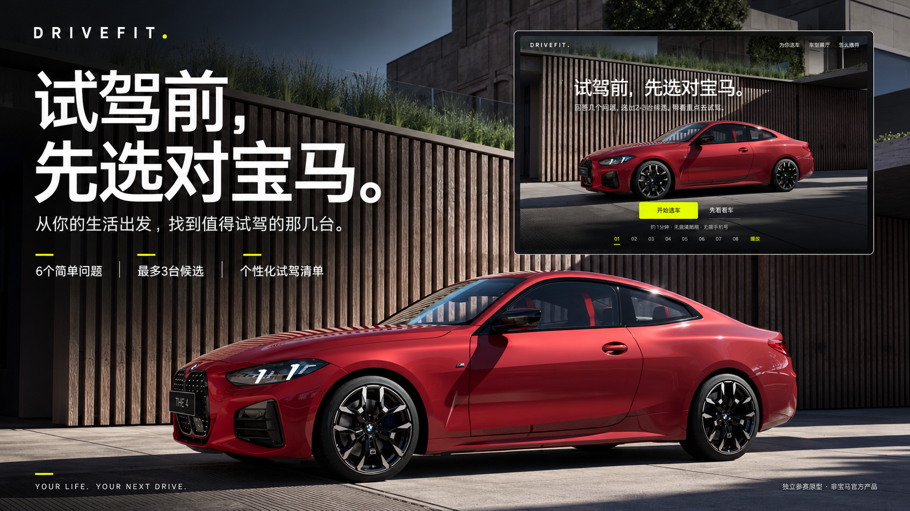
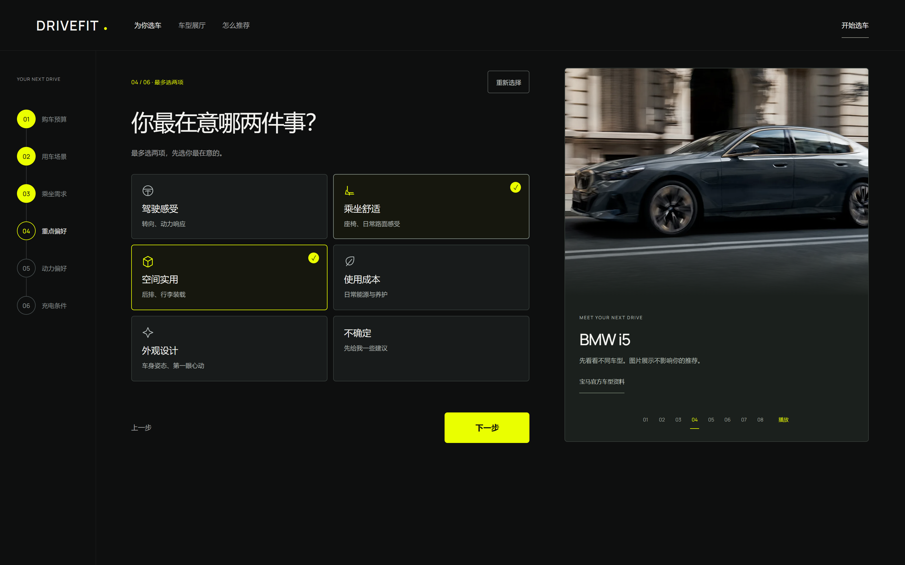
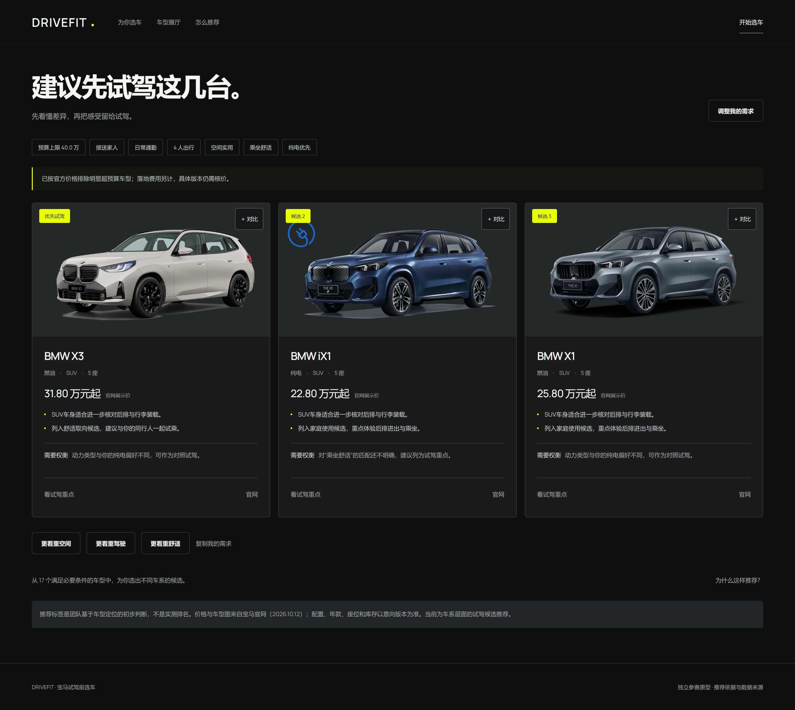
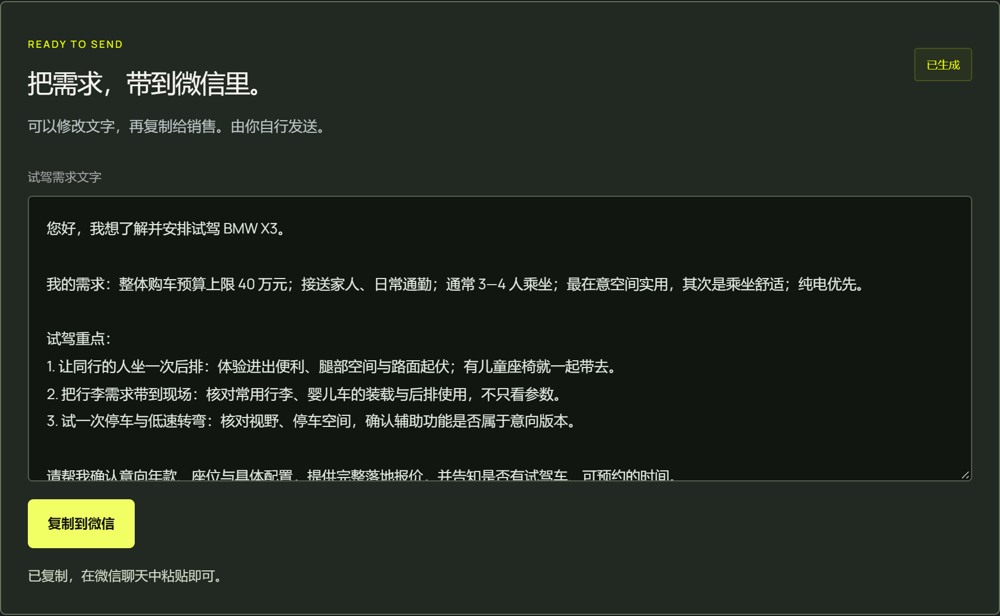
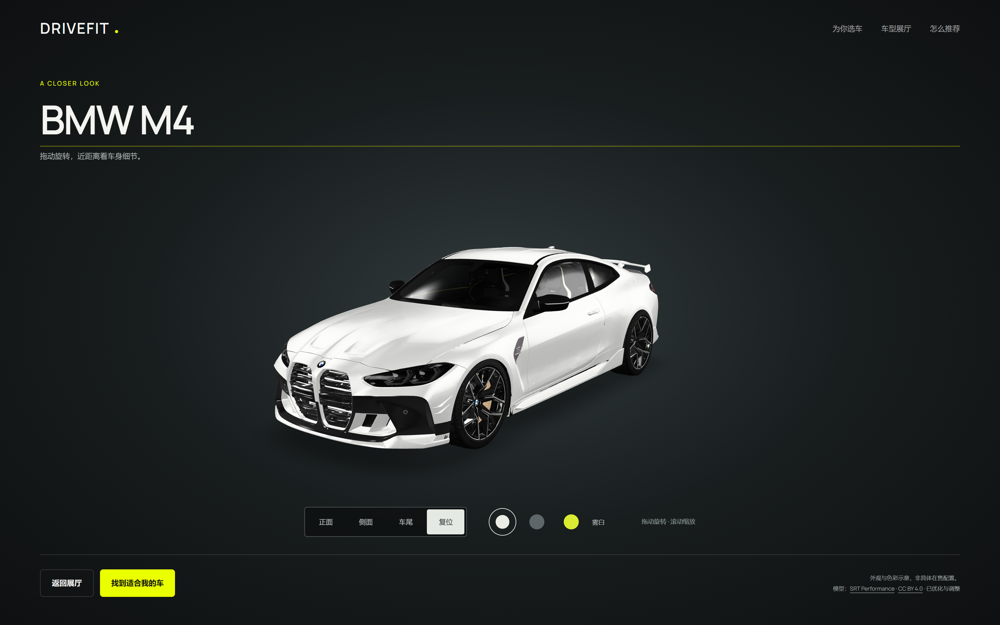

# DRIVEFIT · 宝马试驾前选车

**试驾前，先选对宝马。** 回答几个简单问题，从预算和生活需求出发，找到值得试驾的候选车型，看懂推荐依据，把试驾需求复制到微信。

DRIVEFIT 取自 **Drive + Fit**，表达“找到适合你的下一台车”。这是面向宝马购车场景的独立参赛原型，适合「个性跃迁」赛道的销售体验定制方向。



## 功能

- **轻量选车**：最多 6 道短问题，单选点击即继续，多选最多两项；根据选择追问充电条件或车身需求，支持一键重新选择。
- **车型展厅**：49 个官方目录条目，支持搜索、价格、车身、动力、M 性能和销售状态筛选，最多三台对比。
- **可解释推荐**：先筛预算、座位与必要条件，再按用途和偏好排序；展示筛选数量、逐项得分、推荐理由和取舍。
- **试驾准备**：生成个性化核对清单，下载文本；保存后生成可编辑的微信需求文字，支持复制和手动选中文本。
- **视觉体验**：八款车型图片轮播、可跳过开场、三维外观展示；模型支持旋转、缩放、视角切换和配色预览。
- **使用便利**：适配手机、键盘操作及减少动态效果偏好；无需登录，无手机号收集。

## 本地运行

需要 **Node.js 22 或更新版本**。项目使用原生 HTML、CSS 和 JavaScript，没有第三方安装或构建依赖。

在包含 `server.cjs` 的项目目录打开终端：

```sh
node server.cjs
```

打开 <http://127.0.0.1:4174>。请通过 HTTP 访问，浏览器 ES modules 不适合直接双击 HTML 文件运行。

检查和测试：

```sh
npm run check
npm test
```

也可以直接运行 `node --test tests/*.test.mjs`。测试覆盖预算、座位、必要条件、偏好排序、空结果、推荐依据及微信分享文字。

## 页面预览

以下为真实运行截图；顶部封面为基于产品的宣传设计图。

| 简单回答 | 候选车型 |
| --- | --- |
|  |  |

| 微信需求文字 | 三维外观展示 |
| --- | --- |
|  |  |

[查看完整推荐依据截图](docs/images/evidence.png)

## 推荐逻辑

推荐结果来自 `dist/recommend.js` 中的公开规则，当前没有接入大模型。

1. 从目录中筛出有官方价格与试驾入口的条目。
2. 根据预算上限、座位数，以及用户设为“必须符合”的动力或车身条件继续筛选。
3. 按以下规则排序，取最多三个不同车系的候选；同分先比较价格，再比较条目 ID。

| 匹配因素 | 分值 | 依据 |
| --- | --- | --- |
| 第一重点偏好 | +5 | 团队基于车型定位整理的标签 |
| 第二重点偏好 | +3 | 团队定位标签 |
| 每项用途匹配 | +2 | 团队场景标签 |
| 动力偏好匹配 | +1 | 车型动力类型 |
| 车身偏好匹配 | +1 | 车型车身类型 |
| 纯电或插混，且充电条件不明确／主要依赖公共充电 | −2 | 用户补能条件 |

页面展示实际筛选数量和得分项。这些分数用于排序，不是车辆测评分、匹配概率或推荐准确率。没有候选时不会自动提高预算或放宽必要条件。

## 目录

```text
.github/workflows/pages.yml  GitHub Pages 部署流程
dist/                       完整静态网站，直接部署此目录
  app.js                    问答、车型筛选、对比和页面交互
  catalog.js                车型数据快照
  recommend.js              筛选、评分和试驾核对清单
  share.js                  微信需求文字
  slides.js                 八款轮播车型配置
  scene.js                  开场、轮播与三维展示
  *.css                     页面样式与动效
  assets/                   本地汽车图片、字体及三维模型
  vendor/                   模型查看器、解码器及许可
docs/                       上传、部署说明和展示图片
scripts/                    目录采集、数据生成和素材研究脚本
tests/                      推荐逻辑及分享文字测试
research/                   图片来源、模型信息和参考记录
catalog-source.json         原始目录采集条目
server.cjs                  本地静态服务器
package.json                开发、检查和测试命令
```

`dist/` 同时包含页面源代码和可直接运行的静态文件，不需要另行构建。导出包不包含原站 Git 历史、托管账号配置或研究缓存。

## 上传和部署

- [上传到 GitHub](docs/UPLOAD.md)：推荐 GitHub Desktop，也提供网页分批上传和 Git 命令。
- [部署到 GitHub Pages](docs/DEPLOY.md)：已附工作流，部署目录为 `dist/`。

## 数据和素材

车型目录快照日期为 **2026-10-12**：49 个条目中，44 个具有展示价格和试驾入口，另外 5 个为咨询或关注条目；后者不进入默认推荐。来源记录见 [research/assets.json](research/assets.json) 和 [research/REFERENCE.md](research/REFERENCE.md)。

候选以车系／官网车型条目为单位，尚未建立完整年款和配置版本库。官网起价不是成交价或落地价，也不代表当地库存；试驾时仍需确认具体版本。场景和偏好标签由团队整理，不是官方推荐标签。

若需更新数据：先将宝马官方车型目录页面保存为项目根目录的 `bmw-source.html`，运行 `node scripts/collect.mjs`，再运行 `node scripts/build-catalog.mjs`。这些脚本会覆盖数据和素材，更新后需人工核对销售状态、标签及数据日期，并重新测试；日常运行无需执行它们。

用户答案与对比状态保存在当前页面内存中，刷新会重置。原型没有实时库存、真实预约、账户系统或金融服务；微信文字是需求草稿，复制后由用户自行发送。

## 素材署名与许可

- BMW 汽车图片来自宝马中国官网，版权属于品牌方；用于独立参赛原型展示。本项目与宝马官方无合作或授权关系。
- BMW M4 艺术模型由 **SRT Performance** 制作，以 **CC BY 4.0** 发布；经简化及纹理／网格压缩。查看 [模型来源和署名](dist/assets/models/CREDITS.txt)。它不表示当前在售版本或官方车漆配置。
- `model-viewer`：保留 [Apache 2.0 许可](dist/vendor/model-viewer-LICENSE.txt)。
- Meshoptimizer 解码器：保留 [MIT 许可](dist/vendor/meshoptimizer-LICENSE.txt)。
- Manrope 字体：保留 [SIL Open Font License](dist/assets/fonts/Manrope-OFL.txt)。

当前未为原创网站源码指定开源许可证；第三方素材分别遵循上述许可与权利说明。上传到公开仓库前，可由项目作者选择适合的源码许可证，图片和模型不会因此自动获得同样的许可。
